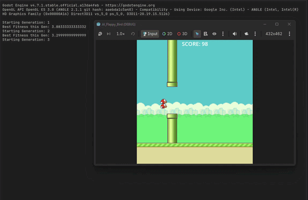

# 🐦 AI Flappy Bird

> An AI that teaches itself to play Flappy Bird, built in **Godot** using the **NEAT** (NeuroEvolution of Augmenting Topologies) algorithm.




---

## Table of Contents

- [Overview](#overview)
- [What is NEAT?](#what-is-neat)
- [How the AI Learns](#how-the-ai-learns)
- [Project Structure](#project-structure)
- [Getting Started](#getting-started)
- [Configuration](#configuration)
- [Exporting the Game](#exporting-the-game)
- [Tech Stack](#tech-stack)
- [Results](#results)
- [Roadmap](#roadmap)
- [Contributing](#contributing)
- [License](#license)
- [Acknowledgements](#acknowledgements)

---

## Overview

Flappy Bird is a simple game with a hard requirement: tap at exactly the right moment to pass through gaps between pipes. This project doesn't hard-code that skill. Instead, a population of birds, each controlled by its own small neural network, plays the game over many generations. Birds that survive longer pass on their "genes", and over time the population evolves into birds that play the game well.

The project is built entirely inside the Godot engine, so the game, the evolution process, and the visualization all live in one place.

## What is NEAT?

**NEAT** (NeuroEvolution of Augmenting Topologies, Stanley & Miikkulainen, 2002) is a genetic algorithm that evolves both the **weights** and the **structure** of neural networks.

Key ideas:

- **Start simple.** Networks begin with no hidden neurons, directly connecting inputs to outputs.
- **Grow complexity only when it helps.** Mutations can add new connections and neurons, so networks become only as complex as the task requires.
- **Speciation.** Genomes are grouped into species by similarity, so new structural innovations get time to improve before competing with the whole population.
- **Historical markings.** Each gene has an innovation number, which lets different network structures be crossed over meaningfully.

## How the AI Learns

The loop below repeats every generation:

```
┌──────────────────┐   ┌──────────────────┐   ┌──────────────────┐
│ 1. Spawn a       │   │ 2. Each bird     │   │ 3. Score fitness │
│    population of │──►│    senses the    │──►│    (survival     │
│    birds, each   │   │    world and     │   │    time, pipes   │
│    with a genome │   │    decides to    │   │    passed)       │
└──────────────────┘   │    flap or not   │   └────────┬─────────┘
          ▲            └──────────────────┘            │
          │                                            ▼
┌─────────┴────────┐                          ┌──────────────────┐
│ 5. Next          │◄─────────────────────────│ 4. Select, cross │
│    generation    │                          │    over & mutate │
└──────────────────┘                          │    (per species) │
                                              └──────────────────┘
```

**Actual inputs to the network are defined in bird.gd**:

| Input                                  | Why it matters                                  |
| -------------------------------------- | ----------------------------------------------- |
| Bird's vertical position               | Where the bird is relative to the screen        |
| Horizontal distance to the next pipe   | How soon a decision is needed                   |
| Vertical position of the pipe gap      | Where the bird needs to go                      |

These are normalized by screen/viewport size before being passed to the network.

**Output:** a single value from a sigmoid output neuron. If the output is greater than 0.5 and the bird is currently falling (velocity.y > 0), the bird flaps.

**Fitness:** birds gain fitness by surviving: fitness += delta while alive and flying. Passing pipes increments the global score in main.gd, but it does not currently add extra fitness to the bird.

> 📝 *Adjust the inputs, outputs, and fitness description above to match your implementation.*

## Project Structure

```
AI_Flappy_Bird/
├── assets/               # Sprites, backgrounds, audio and other game resources
├── scenes/               # Godot scenes (main.tscn is the entry scene) and attached scripts
├── .gitattributes
├── .gitignore
├── export_presets.cfg    # Godot export configuration
├── icon.svg              # Project icon
├── icon.svg.import
├── project.godot         # Godot project configuration
└── README.md
```

**Project settings** (from `project.godot`):

| Setting          | Value                       |
| ---------------- | --------------------------- |
| Project name     | `AI_Flappy_Bird`            |
| Main scene       | `res://scenes/main.tscn`    |
| Engine features  | Godot 4.x, GL Compatibility |
| Window size      | 432 × 462                   |

The **GL Compatibility** renderer keeps the game lightweight and lets it run on almost any hardware, including web exports.

## Getting Started

### Prerequisites

- [Godot Engine 4.x](https://godotengine.org/download) (the project targets the 4.0 feature set; a recent stable 4.x release is recommended)
- Git

### Installation

```bash
# 1. Clone the repository
git clone https://github.com/Sadim-Verse/AI_Flappy_Bird.git
cd AI_Flappy_Bird
```

### Run the project

1. Open Godot and click **Import**.
2. Select the `project.godot` file in the cloned folder.
3. Click **Import & Edit**.
4. Press **F5** (or the ▶ button) to run. The main scene is `scenes/main.tscn`.

You will see the first generation of birds appear. Most will fail quickly, but within a few generations the population should begin clearing pipes consistently.

## Configuration

NEAT's behavior is controlled by a handful of parameters. These are the values currently used in the project:

| Parameter                      | Description                                          | Value |
| ------------------------------ | ---------------------------------------------------- | ----- |
| Population size                | Birds per generation                                 | 50    |
| Weight mutation rate           | Chance a connection weight is perturbed              | 80% chance to perturb by ±0.5; if not perturbed, 10% chance to fully randomize (≈2% overall) |
| Compatibility threshold        | Genome distance that defines a species               | N/A — Genome.distance() returns 0.0; no speciation is used |
| Flap threshold                 | Network output above which the bird flaps            | 0.5, plus velocity.y > 0 |
| Max generations                | Upper limit on evolution                             | Unlimited |

**Tuning tips:**

- A larger population explores more but runs slower.
- If evolution stalls, raise mutation rates or lower the compatibility threshold to encourage more species.
- If networks bloat, lower the add-node and add-connection rates.

> In the current code, only weight mutation is active. Adding connection/node mutations would require extending Neat_Manager.gd and Genome.gd.

## Exporting the Game

The repository includes `export_presets.cfg`, so export presets are already defined.

1. In Godot, open **Project → Export**.
2. Choose a preset and install any missing export templates when prompted.
3. Click **Export Project** and choose a destination.

For a web build, serve the exported files over HTTP (for example with `python -m http.server`) rather than opening `index.html` directly.

## Tech Stack

| Component        | Technology                                          |
| ---------------- | --------------------------------------------------- |
| Game engine      | [Godot 4](https://godotengine.org/)                 |
| AI algorithm     | NEAT-inspired neuroevolution                               |
| Rendering        | GL Compatibility                                    |
| Version control  | Git (Git attributes configured for Godot assets)    |

## Results

| Metric                                   | Value |
| ---------------------------------------- | ----- |
| Generations to first pipe cleared        | 2-3 |
| Generations to a consistently surviving bird | 3-50+ |
| Best score achieved                      | 459.5333+ |

## Roadmap

- [ ] Display live generation, species count, and best fitness on screen
- [ ] Visualize the best network's structure in real time
- [ ] Save and load the best genome so a trained bird can be replayed instantly
- [ ] Add a "human vs. AI" mode
- [ ] Add adjustable game speed to accelerate training
- [ ] Publish a playable web build
- [ ] Add a chart of fitness per generation

## Contributing

Contributions, ideas, and bug reports are welcome.

1. Fork the repository.
2. Create a branch: `git checkout -b feature/your-feature`
3. Commit your changes: `git commit -m "Add your feature"`
4. Push to your branch: `git push origin feature/your-feature`
5. Open a pull request.

Or [open an issue](https://github.com/Sadim-Verse/AI_Flappy_Bird/issues) to discuss a change first.

## License

No license has been specified yet. Consider adding a `LICENSE` file (for example MIT) so others know how they can use this project.

## Acknowledgements

- K. O. Stanley and R. Miikkulainen, ["Evolving Neural Networks through Augmenting Topologies"](https://nn.cs.utexas.edu/downloads/papers/stanley.ec02.pdf) (2002), the original NEAT paper
- The [Godot Engine](https://godotengine.org/) community
- The original Flappy Bird by Dong Nguyen, which inspired this project

---

Built by [Sadim-Verse](https://github.com/Sadim-Verse). 🐤
